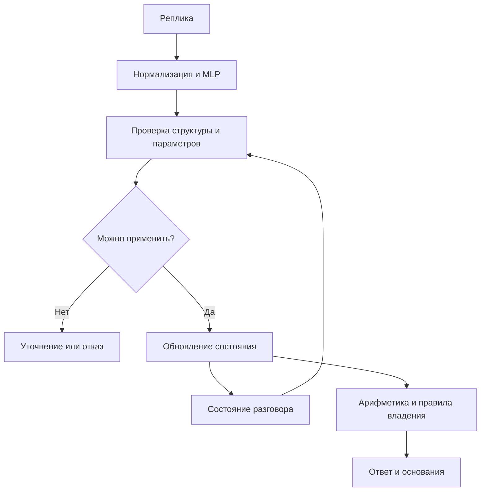

# TinyTalk Reason 1.0 — контекст и проверяемое рассуждение

Маленький офлайн-прототип на C11. Развитие TinyTalk: добавлены состояние диалога,
исправления, уточняющие вопросы и вывод по фактам. `Reason` означает выполнение
явных правил вывода; это не заявление о сознании или универсальном понимании языка.

## Главная идея и особенности проекта

**TinyTalk Reason — основа компактного локального помощника, который превращает
реплики в изменения состояния и вычисляет ответы по сохранённым фактам.**
Предполагаемая область применения — ограниченный набор задач на персональном,
мобильном или встраиваемом устройстве, где важны автономность и контроль ресурсов.

Под «уникальностью» здесь понимается сочетание свойств конкретного прототипа,
а не доказанный новый класс моделей. Нейросеть с правилами, память диалога и
символический вывод известны в исследованиях; ссылки приведены ниже.

| Особенность | Практическое значение | Что уже подтверждено |
|---|---|---|
| Языковой модуль отделён от памяти и вычислений | Новые числа и факты не требуется превращать в отдельные классы ответов | Остаток калорий вычисляется из значений текущего диалога |
| Явное состояние | Можно проверить, что запомнено, исправлено и почему получен ответ | `/state`, исправления последнего события, ссылки на номера реплик |
| Небольшая обучаемая часть | Для предусмотренных функций не нужна большая языковая модель | MLP: 2048 входных признаков, 48 скрытых нейронов, 11 меток |
| Разделение интерпретации и исполнения | Ошибка предложения сети не обязана автоматически изменять данные | Изменения ограничены разбором параметров и проверками; полного исключения ошибок нет |
| Вычисляемые ответы | Можно получить результат, которого не было среди готовых ответов обучения | Арифметика с новыми числовыми комбинациями и обновление владельца объекта |
| Наблюдаемые основания | Можно проверить правило и факты, использованные для ответа | `--trace` показывает выполненные операции, а не имитацию внутреннего монолога |
| Ядро C11 без стороннего нейросетевого runtime | Проще исследовать переносимость и накладные расходы | Сборка и проверки на Linux/GCC; другие устройства требуют отдельных испытаний |

Это более функциональная система, чем исходный TinyTalk с выбором готовой строки.
При этом она пока существенно ограничена явно заданными конструкциями языка.

## Нужно ли обучение и насколько малы расходы

**Обучение требуется маленькой нейросети.** Текущий классификатор обучается с нуля
на 225 примерах с использованием градиентного спуска. Память разговора, арифметика
и правила владения не обучаются: их поведение определено кодом.

| Изменение | Нужно ли переобучение? |
|---|---|
| Сообщить другое число калорий или исправить прежнее | Нет: обновляется состояние диалога |
| Назвать новый объект в поддержанной конструкции | Нет: создаётся запись в памяти |
| Улучшить распознавание незнакомых перефразировок | Возможно: нужны новые примеры и/или доработка разбора |
| Добавить новую предметную область | Нужны схема данных, операции, правила и тесты; может понадобиться обучение |
| Добавить новое физическое или системное действие | Нужен программный адаптер; обучение само не создаёт исполнитель |

Потенциально готовый checkpoint можно поставлять вместе с приложением, чтобы
пользователь вообще не запускал обучение. Это способ поставки, а не отсутствие
обучения при разработке. Сейчас исходный архив создаёт checkpoint при первом запуске.

В текущей конфигурации 98 891 обучаемый параметр — около 386 КиБ float-весов.
На Linux-стенде `sizeof(Model)` составил 445 648 байт, а `sizeof(State)` —
22 984 байта. Эти числа **не равны полному потреблению оперативной памяти**:
нужно учитывать стек, временные массивы, библиотеку C и другие расходы процесса.
Обучение дополнительно хранит примеры и расходует больше памяти, чем инференс.

На одну реплику выполняется небольшой проход MLP и ограниченные операции над
состоянием, без генерации длинной последовательности токенов. Это основание
исследовать малые затраты, но не доказательство «минимальных вычислений».
Сравнение с сильным алгоритмом на правилах, измерение энергии, P95 задержки и
полного RSS ещё предстоят. Для части задач правила без сети могут оказаться дешевле.

## Как развивать TinyTalk Reason

Этапы ниже — план; они не заявлены как возможности версии 1.0.

| Этап | Что добавить | Как проверить результат |
|---|---|---|
| 1. Надёжный языковой разбор | Извлечение действия, объекта, числа, единиц; падежи, варианты формулировок, сложные отрицания | Независимые реплики людей, отдельная оценка намерений и параметров |
| 2. Контекст в обучаемой части | Подавать тему, ожидаемый параметр и выбранный объект в классификатор; при необходимости сравнить с небольшой GRU | Одинаковая фраза в разных диалогах должна давать разные правильные интерпретации |
| 3. Сохранение памяти | История изменений, время, источник факта, сохранение между запусками, разделение пользователей | Восстановление сеанса, отмена правок, отсутствие смешения данных |
| 4. Управление неопределённостью | Несколько гипотез интерпретации, проверка уверенности, осмысленные уточнения | Доля ошибочных действий и отказов на неоднозначных и посторонних запросах |
| 5. Составные задачи | Ограниченный планировщик с предусловиями, зависимостями и последствиями действий | Верные планы на новых комбинациях знакомых операций, обнаружение невозможных планов |
| 6. Реальные приложения | Адаптеры для файлов, настроек, оборудования; подтверждение изменений и обработка ошибок исполнения | Сначала имитация, затем изолированные испытания и проверка фактического результата |
| 7. Перенос на устройства | Отделить обучение от инференса; исследовать квантование, ограничения памяти и CPU | Linux, macOS, Android и выбранная встраиваемая платформа: качество, RSS, P95, энергия |

Большая часть сложности находится на границе языка и структуры: определить,
что именно человек сообщил и к какому объекту относится фраза. Если неправильно
извлечены факты, даже безошибочная арифметика даст неверный ответ.

Новая область должна добавляться как отдельный пакет: схема объектов, разрешённые
операции, примеры языка, правила и тесты. Расходы на создание таких пакетов нужно
учитывать наряду с расходами CPU — ручная настройка не бесплатна.

## До какого конечного результата можно довести

**Реалистичная продуктовая цель — компактный офлайн-движок предметного диалога
и выполнения задач с памятью, уточнениями и проверяемым планом действий.**
Разработчик подключает его к приложению и описывает доступные операции; пользователь
общается с приложением обычными фразами в пределах поддержанной области.

Пример целевого поведения, ещё не реализованного в версии 1.0:

```text
Пользователь: Перенеси вчерашний отчёт в папку «Работа».
Система: Нашла два отчёта за вчера. Какой выбрать?
Пользователь: Тот, что про расходы.
Система: Выбран «Расходы.xlsx». Перенести в «Работа»?
Пользователь: Нет, скопируй, исходник оставь.
Система: План исправлен на копирование. [Проверка и выполнение адаптером]
Система: Копия создана; исходный файл сохранён. [Только после проверки результата]
```

Возможные продукты: помощник внутри приложения, интерфейс локального оборудования,
учётный помощник или средство управления ограниченным набором функций телефона.
Обработка голоса потребует отдельного распознавания речи и отдельного бюджета
ресурсов; TinyTalk Reason сейчас принимает только текст.

Внутри уже есть полноценная небольшая нейронная сеть. Дальнейшее развитие может
сделать её интерпретацию языка гибче и добавить обучаемую память. Однако превращение
в универсальную модель уровня LLM без больших данных и вычислений из этих результатов
не следует. Расширение областей, контекста и способностей может увеличить и стоимость
обучения, и требования к устройству.

Критерий завершённости продукта: на заранее определённом наборе задач система
правильно понимает независимые запросы, ведёт многошаговый диалог, уточняет
неопределённость, проверяет результат действий и укладывается в заданный ресурсный
бюджет. Утверждение о «сознании» для этой цели не требуется.

## Исследовательская ценность и возможная новизна

Версия 1.0 — воспроизводимый инженерный прототип, не подтверждённая новая теория
мышления. Исследовательский вопрос: **может ли компактное явное состояние повысить
качество многошагового диалога при меньшем бюджете данных и памяти, чем альтернативы?**

Возможный предмет дальнейшей работы — конкретный метод выбора того, какие факты
и гипотезы сохранять при ограниченном объёме памяти, с учётом их значимости для
текущей задачи. Его нужно разработать, сравнить с существующими методами и проверить.
Это кандидат на исследование, а не установленная научная новизна.

Сравнение должно включать сильную систему на правилах, классификатор без контекста,
классификатор с историей и предлагаемый гибрид. Измерять следует качество полного
диалога, ошибки исполнения, число уточнений, стоимость подготовки данных, задержку
и память. Более мощная модель может служить ориентиром качества, но одна победа
над LLM по размеру не доказывает преимущество метода.

Текущие 75 регрессионных шагов и 3442 проверки подтверждают предусмотренные сценарии
и свойства кода. Они не измеряют универсальное понимание русского языка. В частности,
сравнение с отключённой MLP использует знакомые ей формулировки; вывод о работе на
новых пользовательских репликах по нему делать нельзя.

## Быстрый запуск (Linux, macOS Intel)

Нужны Bash и компилятор C с системной математической библиотекой. На macOS при
отсутствии компилятора выполните `xcode-select --install` (скачиваются инструменты
Apple). На Linux установите GCC или Clang средствами своего дистрибутива.
Ни Python, ни предобученные модели, ни сторонние C-библиотеки для запуска не нужны.

```bash
cd TinyTalk_Reason
bash start_learning.sh    # обучение MLP с нуля на data.txt
bash start_E.sh           # регрессионные диалоги и контроль классификатора
bash start.sh --trace     # интерактивный диалог + основания ответов в stderr
```

Можно сразу запустить `bash start.sh`: при отсутствии модели обучение запускается
автоматически. Сборка и обучение локальные, скрипты ничего не скачивают.

```bash
bash demo.sh              # готовый диалог из examples.txt
bash test_properties.sh   # 200 диалогов с генерируемыми числами
bash test_sanitizers.sh   # ASan/UBSan, если доступны в компиляторе
bash compare.sh           # тот же текст с MLP и без MLP
EPOCHS=40 bash start_learning.sh --resume  # повторное обучение теми же данными
```

Скрипты запускаются из любой рабочей папки; пути с пробелами поддерживаются.
Проверено на Linux/GCC; macOS Intel и Clang в этом запуске не проверялись.

## Что написать

```text
моя цель 2000 ккал
я съел 300 ккал
обед 500 ккал
сколько осталось
нет, там было 400
сколько осталось
```

Ответы: сначала `Осталось 1200 ккал`, после исправления — `Осталось 1300 ккал`.
В `--trace` видны арифметика и ссылки на номера реплик. Эти основания формируются
из выполненных правил, это не сгенерированный рассказ о скрытых «мыслях».

```text
поставь таймер
на 10 минут
```

Программа связывает вторую реплику с ожидаемым параметром и записывает 600 секунд.
Таймер **учебный**: нет системного запуска, отсчёта времени или уведомлений.

```text
ключ у анна
передай ключ от анна к борис
передай его от борис к вера
у кого ключ?
```

Ответ: владелец — `вера`. `передай ключ от борис к оля` после этого отклоняется:
Борис больше не владелец. Падежи в этом контролируемом языке не склоняются:
используйте одинаковые идентификаторы `анна`, `борис`, `вера`, а не `Анны`, `Борису`.
Допускаются другие однословные имена объектов и людей. «Его» означает последний
однозначно выбранный объект. Это специальное правило, не универсальное разрешение
местоимений. Передача — обновление модели мира, не физическое действие.

Команды: `/state` показывает память, `/reset` очищает её, `/quit` завершает сеанс.
Память диалога живёт только в процессе. Веса сети сохраняются между запусками.

## Устройство



MLP сохранён из TinyTalk: хешированные символьные n-граммы 2–4 и слова,
2048 признаков, 48 скрытых нейронов tanh, softmax. Обучение — SGD с перекрёстной
энтропией. Теперь метки — 11 намерений, а не готовые ответы. В `data.txt` 225
примеров (75 формулировок и их варианты с префиксами). Это маленький искусственный
корпус, не репрезентативная выборка русского языка.

Формально: `z = Parse(u, S); S_new = Update(S, z); answer = Decide(S_new)`.
`Parse` гибридный: MLP предлагает метку, но большинство поддержанных конструкций
разбирается явно написанными правилами. В этой версии MLP непосредственно
расширяет варианты вопросов `remaining` и `total` при score >= 0.85.
Изменения фактов требуют явных параметров; нейросеть не может сама выдумать число.
Остальные её метки пока диагностические, а не самостоятельные исполнители.
Softmax-score не является калиброванной уверенностью.

`compare.sh` отключает MLP. На подготовленных вариантах вопросов эта разница
видна, но тестовые вопросы известны при обучении: это демонстрация использования
сети, не оценка обобщения. Для полноценного научного сравнения нужны независимые
формулировки и более сильный baseline на правилах.

## Ограничения

* Это предметный диалог о калориях, учебных таймерах и владении объектами.
* Правила и данные заданы человеком. Нет доказательства научной новизны.
* Одно действие на реплику; целые неотрицательные числа до 1000000.
* Отрицания и условия консервативно отклоняются. Не все обороты русского языка
  распознаются: например, косвенная речь, сарказм, сложные отрицания не поддержаны.
* 64 события питания, 64 таймера, 64 объекта; переполнение отклоняется.
* Исправление без указания цели меняет последний приём пищи при теме питания.
* Явно заявленная новая цель заменяет прежнюю. Новый владелец существующего
  объекта требует передачи; конфликтующий факт не перезаписывается молча.
* При нескольких таймерах отмена требует уточнения, но выбор по ID ещё не
  реализован. Очистить сеанс можно `/reset`.
* Нет гарантии отказа на всех посторонних фразах: маленький классификатор и
  эвристический разбор могут ошибаться. Не используйте как интерфейс опасных
  или необратимых действий.
* MLP ещё не получает состояние как признаки; контекст использует символический
  модуль. Это гибридная система, а не обученная рекуррентная сеть и не POMDP.
* Формат checkpoint унаследован от TinyTalk: нативные числа/float, не универсальный
  переносимый формат; для другой платформы проще обучить локально из data.txt.

## Файлы

| Файл | Назначение |
|---|---|
| `src/tiny_base.c` | Исходный MLP TinyTalk, обучение и checkpoint |
| `src/reason.c` | Контекст, разбор, проверка фактов, ответ и трасса |
| `data.txt` | Размеченные примеры намерений: текст TAB метка |
| `tests/dialogues.tsv` | Реплика TAB ожидаемый код TAB часть ответа; последовательные сеансы |
| `tests/properties.c` | Проверки состояния, чисел, границ и UTF-8 |
| `tests/intents.tsv` | Smoke-тест MLP на знакомых формулировках |
| `examples.txt` | Готовая демонстрация |
| `results/` | Реальные журналы Linux, включая ограничения эксперимента |
| `docs/IMPLEMENTATION.md` | Функции, формулы и план дальнейшего исследования |
| `models/intent.bin` | Создаётся обучением, не входит в исходный архив |

У `start_learning.sh --resume` прошлый checkpoint копируется в
`models/intent.previous.bin`; следующий успешный результат заменяет `intent.bin`.
Хранится только одна предыдущая версия. Не запускайте два обучения одновременно.
После изменения набора меток переобучите с нуля: движок ожидает определённые
строки `remaining`, `total`, а новые метки сами по себе не добавляют новые операции.

## Научные источники

Архитектура вдохновлена существующими направлениями, но не воспроизводит целиком
алгоритмы указанных работ:

* Williams, Asadi, Zweig (2017), Hybrid Code Networks:
  https://aclanthology.org/P17-1062/
* Young et al. (2013), POMDP-based Statistical Spoken Dialog Systems: A Review:
  https://doi.org/10.1109/JPROC.2012.2225812
* Weston et al. (2015), Towards AI-Complete Question Answering (bAbI):
  https://arxiv.org/abs/1502.05698
* Soar: https://soar.eecs.umich.edu/soar_manual/02_TheSoarArchitecture/

Здесь нет оценки сознания. Есть наблюдаемые операции: запоминание, привязка к
контексту, исправление, отказ при конфликте и вычисление проверяемого ответа.
