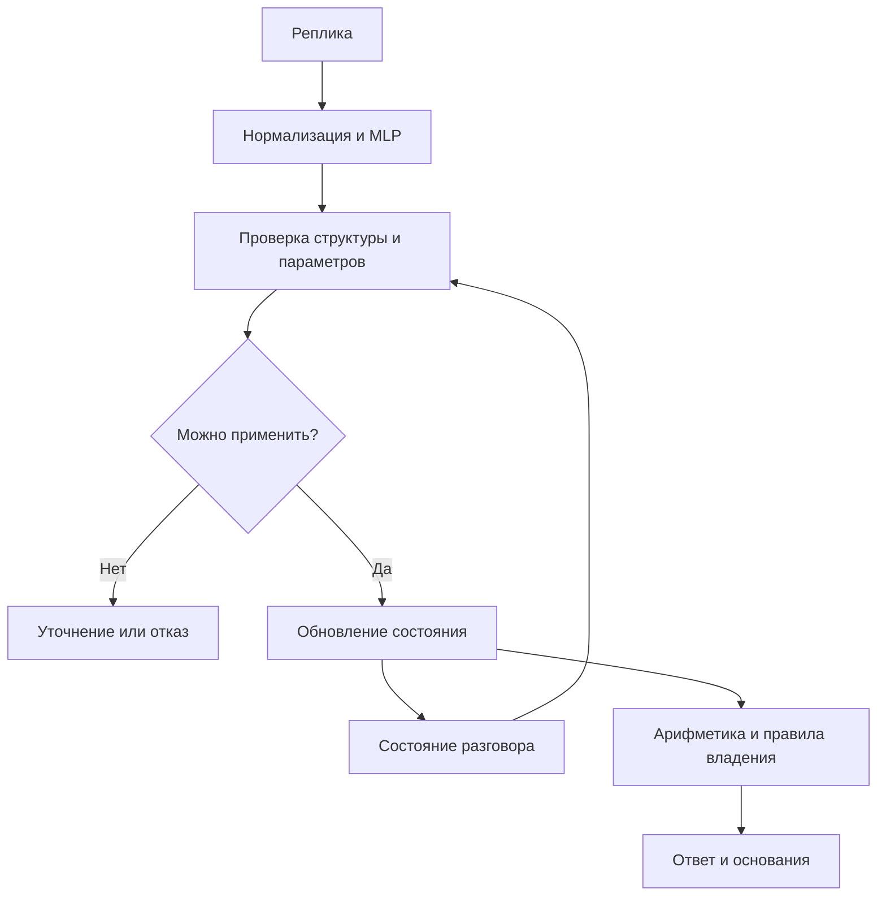

# TinyTalk Reason 1.0 — контекст и проверяемое рассуждение

Маленький офлайн-прототип на C11. Развитие TinyTalk: добавлены состояние диалога,
исправления, уточняющие вопросы и вывод по фактам. `Reason` означает выполнение
явных правил вывода; это не заявление о сознании или универсальном понимании языка.

## Быстрый запуск (Linux, macOS Intel)

Нужны Bash и компилятор C с системной математической библиотекой. На macOS при
отсутствии компилятора выполните `xcode-select --install` (скачиваются инструменты
Apple). На Linux установите GCC или Clang средствами своего дистрибутива.
Ни Python, ни предобученные модели, ни сторонние C-библиотеки для запуска не нужны.

```bash
cd TinyTalk_Reason
bash start_learning.sh    # обучение MLP с нуля на data.txt
bash start_E.sh           # регрессионные диалоги и контроль классификатора
bash start.sh --trace     # интерактивный диалог + основания ответов в stderr
```

Можно сразу запустить `bash start.sh`: при отсутствии модели обучение запускается
автоматически. Сборка и обучение локальные, скрипты ничего не скачивают.

```bash
bash demo.sh              # готовый диалог из examples.txt
bash test_properties.sh   # 200 диалогов с генерируемыми числами
bash test_sanitizers.sh   # ASan/UBSan, если доступны в компиляторе
bash compare.sh           # тот же текст с MLP и без MLP
EPOCHS=40 bash start_learning.sh --resume  # повторное обучение теми же данными
```

Скрипты запускаются из любой рабочей папки; пути с пробелами поддерживаются.
Проверено на Linux/GCC; macOS Intel и Clang в этом запуске не проверялись.

## Что написать

```text
моя цель 2000 ккал
я съел 300 ккал
обед 500 ккал
сколько осталось
нет, там было 400
сколько осталось
```

Ответы: сначала `Осталось 1200 ккал`, после исправления — `Осталось 1300 ккал`.
В `--trace` видны арифметика и ссылки на номера реплик. Эти основания формируются
из выполненных правил, это не сгенерированный рассказ о скрытых «мыслях».

```text
поставь таймер
на 10 минут
```

Программа связывает вторую реплику с ожидаемым параметром и записывает 600 секунд.
Таймер **учебный**: нет системного запуска, отсчёта времени или уведомлений.

```text
ключ у анна
передай ключ от анна к борис
передай его от борис к вера
у кого ключ?
```

Ответ: владелец — `вера`. `передай ключ от борис к оля` после этого отклоняется:
Борис больше не владелец. Падежи в этом контролируемом языке не склоняются:
используйте одинаковые идентификаторы `анна`, `борис`, `вера`, а не `Анны`, `Борису`.
Допускаются другие однословные имена объектов и людей. «Его» означает последний
однозначно выбранный объект. Это специальное правило, не универсальное разрешение
местоимений. Передача — обновление модели мира, не физическое действие.

Команды: `/state` показывает память, `/reset` очищает её, `/quit` завершает сеанс.
Память диалога живёт только в процессе. Веса сети сохраняются между запусками.

## Устройство



MLP сохранён из TinyTalk: хешированные символьные n-граммы 2–4 и слова,
2048 признаков, 48 скрытых нейронов tanh, softmax. Обучение — SGD с перекрёстной
энтропией. Теперь метки — 11 намерений, а не готовые ответы. В `data.txt` 225
примеров (75 формулировок и их варианты с префиксами). Это маленький искусственный
корпус, не репрезентативная выборка русского языка.

Формально: `z = Parse(u, S); S_new = Update(S, z); answer = Decide(S_new)`.
`Parse` гибридный: MLP предлагает метку, но большинство поддержанных конструкций
разбирается явно написанными правилами. В этой версии MLP непосредственно
расширяет варианты вопросов `remaining` и `total` при score >= 0.85.
Изменения фактов требуют явных параметров; нейросеть не может сама выдумать число.
Остальные её метки пока диагностические, а не самостоятельные исполнители.
Softmax-score не является калиброванной уверенностью.

`compare.sh` отключает MLP. На подготовленных вариантах вопросов эта разница
видна, но тестовые вопросы известны при обучении: это демонстрация использования
сети, не оценка обобщения. Для полноценного научного сравнения нужны независимые
формулировки и более сильный baseline на правилах.

## Ограничения

* Это предметный диалог о калориях, учебных таймерах и владении объектами.
* Правила и данные заданы человеком. Нет доказательства научной новизны.
* Одно действие на реплику; целые неотрицательные числа до 1000000.
* Отрицания и условия консервативно отклоняются. Не все обороты русского языка
  распознаются: например, косвенная речь, сарказм, сложные отрицания не поддержаны.
* 64 события питания, 64 таймера, 64 объекта; переполнение отклоняется.
* Исправление без указания цели меняет последний приём пищи при теме питания.
* Явно заявленная новая цель заменяет прежнюю. Новый владелец существующего
  объекта требует передачи; конфликтующий факт не перезаписывается молча.
* При нескольких таймерах отмена требует уточнения, но выбор по ID ещё не
  реализован. Очистить сеанс можно `/reset`.
* Нет гарантии отказа на всех посторонних фразах: маленький классификатор и
  эвристический разбор могут ошибаться. Не используйте как интерфейс опасных
  или необратимых действий.
* MLP ещё не получает состояние как признаки; контекст использует символический
  модуль. Это гибридная система, а не обученная рекуррентная сеть и не POMDP.
* Формат checkpoint унаследован от TinyTalk: нативные числа/float, не универсальный
  переносимый формат; для другой платформы проще обучить локально из data.txt.

## Файлы

| Файл | Назначение |
|---|---|
| `src/tiny_base.c` | Исходный MLP TinyTalk, обучение и checkpoint |
| `src/reason.c` | Контекст, разбор, проверка фактов, ответ и трасса |
| `data.txt` | Размеченные примеры намерений: текст TAB метка |
| `tests/dialogues.tsv` | Реплика TAB ожидаемый код TAB часть ответа; последовательные сеансы |
| `tests/properties.c` | Проверки состояния, чисел, границ и UTF-8 |
| `tests/intents.tsv` | Smoke-тест MLP на знакомых формулировках |
| `examples.txt` | Готовая демонстрация |
| `results/` | Реальные журналы Linux, включая ограничения эксперимента |
| `docs/IMPLEMENTATION.md` | Функции, формулы и план дальнейшего исследования |
| `models/intent.bin` | Создаётся обучением, не входит в исходный архив |

У `start_learning.sh --resume` прошлый checkpoint копируется в
`models/intent.previous.bin`; следующий успешный результат заменяет `intent.bin`.
Хранится только одна предыдущая версия. Не запускайте два обучения одновременно.
После изменения набора меток переобучите с нуля: движок ожидает определённые
строки `remaining`, `total`, а новые метки сами по себе не добавляют новые операции.

## Научные источники

Архитектура вдохновлена существующими направлениями, но не воспроизводит целиком
алгоритмы указанных работ:

* Williams, Asadi, Zweig (2017), Hybrid Code Networks:
  https://aclanthology.org/P17-1062/
* Young et al. (2013), POMDP-based Statistical Spoken Dialog Systems: A Review:
  https://doi.org/10.1109/JPROC.2012.2225812
* Weston et al. (2015), Towards AI-Complete Question Answering (bAbI):
  https://arxiv.org/abs/1502.05698
* Soar: https://soar.eecs.umich.edu/soar_manual/02_TheSoarArchitecture/

Здесь нет оценки сознания. Есть наблюдаемые операции: запоминание, привязка к
контексту, исправление, отказ при конфликте и вычисление проверяемого ответа.
